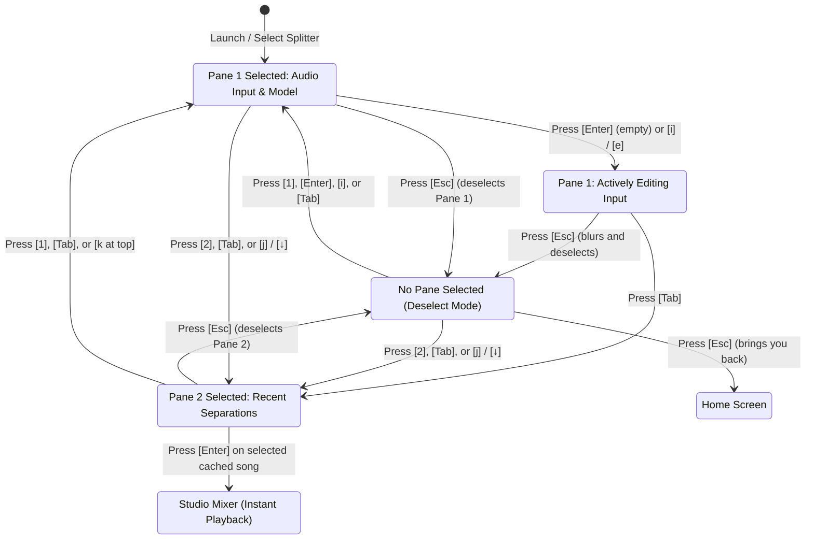

# LISN-TUI: Deselect Mode, Multi-Pane Focus, and Instant Playback Architecture

## 1. Problem Statement & Motivation

In keyboard-centric terminal user interfaces (TUIs), text inputs and multiple interactive cards often create a **focus trap**:
1. When a user focuses a text input box (e.g. typing a file path or YouTube URL), standard navigation keys like `j`, `k`, `h`, `l`, numbers `1-9`, `d`, and `x` are consumed as text input rather than application commands.
2. Previously, pressing `Esc` while typing in the audio input box would bubble up to the global application handler, which executed `goBack()`, kicking the user back to the Home screen rather than simply deselecting the active pane.
3. Panes lacked an explicit **`Not Selected`** state: one pane was always permanently highlighted, so pressing `Esc` on Pane 2 forced focus onto Pane 1, and pressing `Esc` on Pane 1 immediately exited to Home.
4. Users could not easily deselect the active pane, inspect all panes without active highlight, and choose whether to enter another pane or exit.

---

## 2. Architecture & Design Principles

### The Selected vs. Not Selected State Machine

LISN-TUI introduces an explicit **Selected vs. Not Selected** pane lifecycle:

### 1. Pane State Definitions

`DropModel` (`pkg/tui/view_drop.go`) tracks pane focus with `activeFocus int`:
- `activeFocus == -1`: **`No Pane Selected`** (`!IsPaneSelected()`). Both panes display standard borders (`CardStyle`) with no active glow.
- `activeFocus == 0`: **`Pane 1 Selected (Audio Input)`**. Pane 1 glows with Neon Cyan (`CardActiveStyle`).
- `activeFocus == 1`: **`Pane 1 Selected (Model Selection Pills)`**. Model selector active.
- `activeFocus == 2`: **`Pane 2 Selected (Recent Cached Separations)`**. Pane 2 glows with Emerald (`CardActiveStyle`).

### 2. The `ESC` Focus Switch

The `ESC` key governs transitions between `Selected` and `Not Selected`:
- **When any pane is `Selected`**:
  Pressing `ESC` calls `m.dropView.DeselectPane()`, setting `activeFocus = -1` and blurring the text input. The view remains on the Splitter screen, displaying the `○ NO PANE SELECTED` banner.
- **When `No Pane Selected` (`activeFocus == -1`)**:
  Pressing `ESC` triggers `m.goBack()`, smoothly returning the user to the Main Screen (`ViewHome`).

### 3. Navigation Controls

- **Selecting Panes from `Not Selected`**:
  - Press `1`, `Enter`, or `i` $\rightarrow$ Selects Pane 1 and focuses input.
  - Press `2`, `Tab`, or `j` / `↓` $\rightarrow$ Selects Pane 2 (Recent Separations).
  - Press `ESC` $\rightarrow$ Brings you back to Home.
- **Switching Between Panes**:
  - `1` / `2`: Jump directly between Pane 1 and Pane 2.
  - `Tab` / `Shift+Tab`: Cycle between panes.
  - `j` / `k` or `↓` / `↑`: Step down through pills into recent separations, or step up to return to input.

---

## 3. Instant Playback Architecture

When Pane 2 is selected:
1. `m.dropView.SelectedSong()` returns the highlighted `*engine.CachedSong` directly from memory.
2. Pressing `Enter` bypasses file resolution and cache re-querying:
   - Instantiates `audio.NewEngine(sel.Stems)` directly with the pre-cached stem audio paths.
   - Starts playback immediately (`eng.Play()`).
   - Opens the 8-stem Studio Mixer (`ViewPlayer`) with zero perceived latency.
3. Pressing `d` opens the Acoustic Detective report and stem breakdown modal.
4. Pressing `x` initiates the safe delete confirmation dialog, immediately freeing cache storage upon confirmation.

---

## 4. Visual Feedback & Aesthetics

- **`No Pane Selected` Mode Pill**:
  `○ NO PANE SELECTED (DESELECT MODE) [Press 1 / Enter / i to select Audio Track • Press 2 / Tab to select Recent • Esc to Go Back]` (Amber)
- **`Pane 1 Selected` Mode Pill**:
  `● PANE 1 SELECTED: AUDIO TRACK & MODEL [Press Esc to Deselect Pane • Enter/i to Edit • Tab/2/j to select Recent]` (Cyan)
- **`Pane 2 Selected` Mode Pill**:
  `● PANE 2 SELECTED: RECENT CACHED SEPARATIONS [↑/↓, j/k to Select • Enter Instant Play • d Describe • x Delete • Esc to Deselect Pane]` (Emerald)
