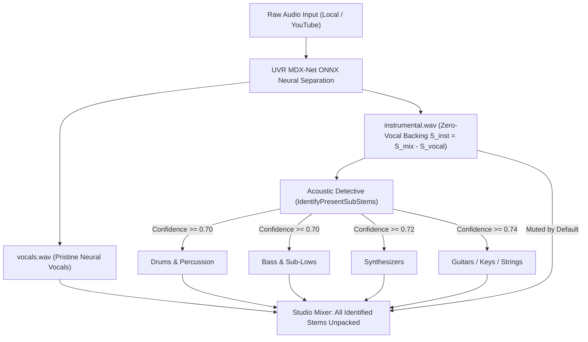

## 1. Overview & Problem Definition

In earlier iterations of LISN-TUI, the multi-stem deconstruction workflow suffered from two critical architectural flaws:

1. **Acoustic Bleed & Vocal Multiplication**:
   - Stereo vocal reverb and delay were mistakenly classified by the acoustic detective as separate "Harmonies" (`StemHarmonyVocals`), which in turn triggered centered "Lead Vocals" (`StemLeadVocals`) extraction.
   - All three vocal stems (`vocals.wav`, `lead.wav`, `harmonies.wav`) were loaded unmuted simultaneously in the mixer, tripling vocal energy and causing vocal bleed across solos.
   - Non-vocal stems fell back to the original mixed audio (`inputFile`) if the neural `instrumental.wav` stem was not strictly enforced, baking vocals directly into drum and bass stems.
2. **Manual Friction (The "Unpack" Barrier)**:
   - Users were forced to manually press `[u]` to trigger secondary stem extraction after separation completed.
   - This broken lifecycle left the studio mixer in an incomplete two-track state until user intervention.

This architecture redesign eliminates both issues by:
- Guaranteeing **mathematically zero vocal bleed** on all non-vocal stems.
- Automating 100% of the acoustic detective and stem extraction pipeline inside `Separate()`, so songs load with all identified stems immediately ready.

---

## 2. Core Architectural Principles

### 2.1 The Zero-Bleed Source Invariant
Any rhythm or melodic sub-stem (`StemDrums`, `StemBass`, `StemSynths`, `StemGuitar`, `StemPiano`, `StemStrings`, `StemBrass`) is **strictly forbidden** from reading mixed input audio.
- Source audio is invariant: `srcAudio = instPath` (`instrumental.wav`).
- If `instrumental.wav` is missing or below 32 KB, execution terminates with an explicit error rather than falling back to mixed audio.
- Because `instrumental.wav` is produced by neural STFT subtraction ($S_{\text{inst}} = S_{\text{mix}} - S_{\text{vocal}}$), it contains no vocal formants. Sub-stems derived from it inherit absolute zero vocal leakage.

### 2.2 Instrumental-Only Detective Scope
- The acoustic detective (`IdentifyPresentSubStems`) exclusively inspects `instrumental.wav`.
- Vocal side-channel pseudo-splitting into `harmonies` and `lead` is deprecated for automatic studio separation.
- The neural `Vocals` stem remains pure, singular, and uncorrupted by phase-canceling stereo artifacts.

### 2.3 Automated End-to-End Unpacking
- During `ONNXRunner.Separate()` for `ModelONNXAuto`:
  1. Forward pass produces base `vocals.wav` and `instrumental.wav`.
  2. Detective immediately inspects `instrumental.wav` and extracts all detected instruments.
  3. Any un-detected or stale stems in the directory are automatically pruned.
  4. The returned `SeparationResult` immediately includes all verified stems.
- Zero manual "unpack" steps are required from the user.

---

## 3. Mixer Muting & Balance Rules

To prevent audio doubling and phase distortion:
- **Instrumental Backing Muting**: When individual rhythm/melodic stems (`Drums`, `Bass`, `Synths`, etc.) are present, the composite `Instrumental` stem is automatically initialized with `t.Muted = true`.
- **Composite Vocal Muting**: If dedicated decomposed vocal stems (`Lead Vocals`, `Harmonies`) exist, the composite `Vocals` stem is initialized with `t.Muted = true`.
- **Default Playback State**: The user hears `Vocals` + `Drums` + `Bass` + `Synths` in perfect acoustic balance.
- **Solo Isolation**: Soloing `Drums` yields purely drums with zero vocals. Soloing `Vocals` yields purely vocals with zero rhythm.
