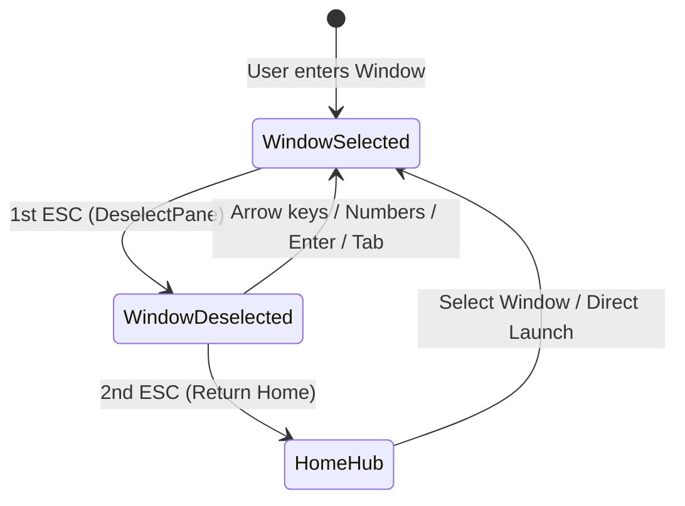

# LISN-TUI Architecture: Universal ESC Navigation Hierarchy & Multi-Window Deselect Mode

This document specifies the architectural model for hierarchical keyboard navigation across all interactive workspace windows in LISN-TUI.

## 1. Motivation & UX Problem

In terminal user interfaces with multiple panels, nested inputs, and multi-track audio playback controls, the `ESC` key often suffers from ambiguous or conflicting behavior:
- Should pressing `ESC` blur the active input field?
- Should pressing `ESC` unselect a highlighted channel, song, or log row?
- Should pressing `ESC` pop backward in the navigation stack to the Home Hub?

Previously, LISN-TUI handled this inconsistently:
- The Splitter window (`ViewDrop`) implemented an explicit 2-step hierarchy: 1st `ESC` unselected the active pane (entering `○ NO PANE SELECTED` mode), and 2nd `ESC` returned to Home.
- The Studio Mixer (`ViewPlayer`) did not handle `ESC` when audio was loaded, requiring users to know modal shortcut numbers or command palette commands.
- The Library (`ViewCache`), Doctor (`ViewDoctor`), Logs (`ViewLogs`), and Export (`ViewExport`) windows immediately popped the navigation stack on the 1st `ESC`, making it impossible to deselect active cursors or inspect unfocused views without leaving the window.

## 2. Universal Navigation Invariant

Every workspace window in LISN-TUI adheres to the **Two-Tier Escape Hierarchy**:

$$\text{Active/Focused Pane} \xrightarrow{\text{ESC}} \text{Deselect Mode (Unselected)} \xrightarrow{\text{ESC}} \text{Home Hub (WindowHome)}$$

### Universal Contract

Every view model exposes the focus interface:
```go
type FocusableModel interface {
    IsPaneSelected() bool
    DeselectPane()
    SelectPane(idx int)
}
```

When user inputs `ESC`:
1. **Tier 1 (Within Window)**: If `view.IsPaneSelected()` is `true`, invoke `view.DeselectPane()`. The window stays active, cursor highlights and `▶ ` markers disappear, cards shift from `CardActiveStyle` to `CardStyle`, and the footer toolbar displays deselect guidance (`[↑/↓] or [1-8] Select Channel   [Esc] Home`).
2. **Tier 2 (Across Windows)**: If `view.IsPaneSelected()` is `false`, invoke `m.switchToWindow(WindowHome)`. The view transitions directly to the main Home dashboard.
3. **Re-selection**: Pressing navigation arrows (`↑/↓`, `j/k`), numbers (`1-8`), `Enter`, or focus keys immediately restores active selection without requiring mouse interaction or command mode.



## 3. Window Implementation Matrix

| Window | Model | Selected State (`IsPaneSelected() == true`) | Deselect Mode (`IsPaneSelected() == false`) | Re-selection Triggers |
| :--- | :--- | :--- | :--- | :--- |
| **Splitter** (`WindowSplitter`) | `DropModel` | `activeFocus >= 0` (Input, Model Pills, or Recents) | `activeFocus = -1`, inputs blurred, card dimmed | `1` (Input), `2` (Recents), `Tab`, `Enter`, `i` |
| **Studio Mixer** (`WindowMixer`) | `PlayerModel` | `selectedIdx >= 0` (`▶ ` channel highlighted) | `selectedIdx = -1`, channel actions guarded against panic | `↑/↓`, `j/k`, `1-8`, `Enter` |
| **Library** (`WindowLibrary`) | `CacheViewModel` | `cursor >= 0` (`▶ ` song highlighted) | `cursor = -1`, table rows unhighlighted | `j/k`, `↑/↓`, `g/G`, `Enter` |
| **System Doctor** (`WindowDoctor`) | `DoctorModel` | `activeFocus = 0` (`CardActiveStyle`) | `activeFocus = -1` (`CardStyle` dimmed) | `Tab`, `Enter`, `1`, `j/k` |
| **Logs** (`WindowLogs`) | `LogsModel` | `cursor >= 0` (`▶ ` log line highlighted) | `cursor = -1`, autoscroll stopped, card dimmed | `j/k`, `↑/↓`, `g/G`, `s` |
| **Export** (`WindowExport`) | `ExportModel` | `destInput.Focused() == true` or `activeFocus >= 0` | `destInput.Blur()`, `activeFocus = -1` | `i`, `Enter`, `Tab` |
| **Home Hub** (`WindowHome`) | `HomeModel` | `cursorIdx >= 0` (`▶ ` workspace card highlighted) | `cursorIdx = -1`, cards dimmed | `↑/↓`, `j/k`, `1-6`, `Enter` |

## 4. Safety & Robustness

In `PlayerModel`, deselecting channels sets `selectedIdx = -1`. Previously, DSP controls (`+`/`-` volume, `m` mute, `s` solo) indexed `m.engine.Tracks[m.selectedIdx]` without bounds checks below zero. The implementation now strictly guards all track mutations:
```go
if m.selectedIdx >= 0 && m.selectedIdx < len(m.engine.Tracks) {
    t := m.engine.Tracks[m.selectedIdx]
    // ... apply volume or mute ...
} else {
    m.setNotice("Select a channel first ([↑/↓] or [1-8])")
}
```

This guarantees zero nil-pointer dereferences or out-of-range slice panics when in Deselect Mode.

## 5. Verification

The navigation behavior is verified by unit test `TestUniversalEscDeselectAndHome` in `pkg/tui/app_test.go`, which exercises the full two-step escape sequence and re-selection across every workspace window.
