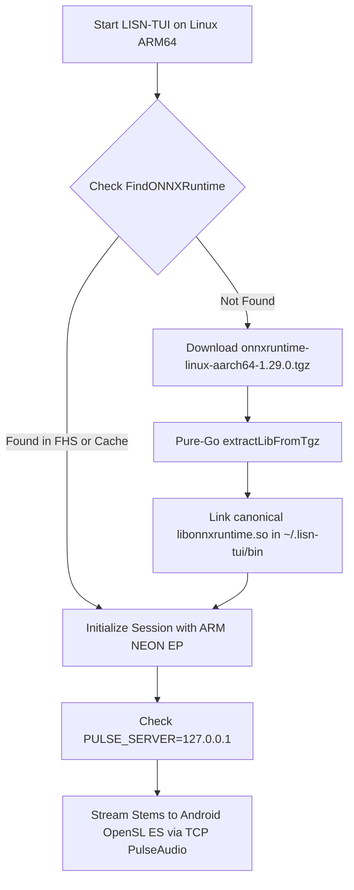

# LISN-TUI Architecture: Linux ARM64, Android Termux, and Mobile Audio Bridging

This architectural specification documents the cross-platform runtime engine, automated native binary bootstrap, and audio routing bridge required to execute LISN-TUI on 64-bit ARM Linux environments, specifically Android mobile devices running Termux.

---

## 1. Challenges on Android / Termux

Running a low-latency, neural-powered audio workstation in a smartphone terminal presents three primary architectural challenges:

### 1.1 CGO & The Bionic vs. Glibc Boundary
`github.com/yalue/onnxruntime_go` requires CGO to link dynamically against `libonnxruntime.so`. Official Microsoft ONNX Runtime binaries are built and linked against GNU `glibc`.
Native Termux, however, runs directly against Android's native Bionic libc. Official ONNX Runtime shared objects cannot load directly in bare Termux without ABI conflicts.
- **Architectural Solution**: Execute LISN-TUI inside a `proot-distro` container (e.g. PRoot Ubuntu `aarch64`). PRoot uses `ptrace` system call interception to provide a complete, standard Linux userspace with `glibc` and full APT repository access, while running directly on the host ARM64 CPU without virtualization penalty.

### 1.2 Android Audio Sandbox & PulseAudio TCP Bridge
Android restricts direct access to `/dev/snd` (ALSA) for non-root applications. LISN-TUI's real-time audio playback engine uses `faiface/beep` with the `oto` backend. On Linux, `oto` automatically routes to PulseAudio.
- **Architectural Solution**: 
  1. Termux host runs PulseAudio with the OpenSL ES sink module and a localhost TCP listener:
     ```bash
     pulseaudio --start --load="module-native-protocol-tcp auth-ip-acl=127.0.0.1 auth-anonymous=1" --exit-idle-time=-1
     ```
  2. Inside the PRoot environment, `export PULSE_SERVER=127.0.0.1` bridges all PCM audio streams across the localhost loopback directly into the Android audio hardware (speaker, USB-C DAC, or Bluetooth A2DP).

### 1.3 Automatic Runtime Resolution & Tarball Decompression
Desktop Windows downloads `.zip` archives containing `onnxruntime.dll`. Linux ARM64 builds from Microsoft are published as `.tgz` / `.tar.gz` archives (`onnxruntime-linux-aarch64-1.29.0.tgz`).
- **Architectural Solution**: Implement pure-Go in-process archive decompression (`archive/tar` + `compress/gzip`) in `pkg/engine/onnx.go`, automatically resolving and extracting `libonnxruntime.so` into the application cache directory (`~/.lisn-tui/bin`).

---

## 2. Dynamic Library Discovery Model

`FindONNXRuntime()` was expanded with a multi-tier search path hierarchy:

1. **Explicit Override**: `LISN_ONNX_PATH` or `ONNXRUNTIME_LIB_PATH` environment variables.
2. **Application Cache**: `~/.lisn-tui/bin/libonnxruntime.so` (automated downloads).
3. **Local Directory**: `./libonnxruntime.so` or `./bin/libonnxruntime.so`.
4. **Standard Linux & Termux FHS Directories**:
   - `/usr/lib/libonnxruntime.so`
   - `/usr/local/lib/libonnxruntime.so`
   - `/data/data/com.termux/files/usr/lib/libonnxruntime.so` (native Termux builds)
5. **System PATH**: Inquires OS `PATH` for `libonnxruntime.so`.



---

## 3. Pure-Go Streaming Tarball Decompressor (`extractLibFromTgz`)

To eliminate external dependencies on system `tar` or `gzip` binaries, `pkg/engine/onnx.go` integrates `extractLibFromTgz`:

```go
func extractLibFromTgz(tgzPath string, destDir string, targetPrefix string) error {
	f, err := os.Open(tgzPath)
	if err != nil {
		return err
	}
	defer f.Close()

	gz, err := gzip.NewReader(f)
	if err != nil {
		return err
	}
	defer gz.Close()

	tr := tar.NewReader(gz)
	for {
		hdr, err := tr.Next()
		if err == io.EOF {
			break
		}
		if err != nil {
			return err
		}
		base := filepath.Base(hdr.Name)
		if strings.HasPrefix(base, targetPrefix) {
			outPath := filepath.Join(destDir, base)
			// Stream bytes into destination file...
			// Create canonical symlink or copy fallback...
		}
	}
    return nil
}
```

---

## 4. Hardware Optimization: ARM NEON

On ARM64, the inference runner queries `runtime.GOARCH == "arm64"` and configures the execution provider string to:
`CPU (ARM NEON Optimized)`

Modern smartphone SoCs (Qualcomm Snapdragon, MediaTek Dimensity, Google Tensor, Samsung Exynos) execute MDX-Net 44.1kHz STFT spectrogram neural passes via 128-bit NEON vector registers, delivering near-desktop neural inference throughput in your pocket.
