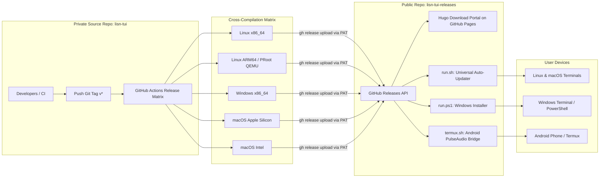

# LISN-TUI Architecture: Automated Multi-Platform Release Pipeline & Public Distribution Hub

This document defines the architectural topology for distributing pre-compiled LISN-TUI binaries across desktop and mobile platforms without exposing private source code or requiring user-side compilation.

---

## 1. Dual-Repository Distribution Model

To maintain private source code control while delivering zero-friction public distribution (analogous to the `0_ath_client` $\rightarrow$ `0_ath_releases` pipeline), the architecture separates source development from artifact delivery:

---

## 2. Release Matrix Specification

The GitHub Actions workflow in `.github/workflows/release.yml` targets 5 platform architectures:

| Platform Tag | Runner OS | Build Toolchain | Target Archive | Target Environment |
| :--- | :--- | :--- | :--- | :--- |
| `linux_amd64` | `ubuntu-latest` | Go 1.24 + `libasound2-dev` | `lisn_linux_amd64.tar.gz` | Linux x86_64 (AVX2/FMA) |
| `linux_arm64` | `ubuntu-latest` (QEMU) | Docker `golang:1.24` ARM64 + `libasound2-dev` | `lisn_linux_arm64.tar.gz` | Android PRoot Ubuntu / SBCs |
| `windows_amd64` | `windows-latest` | Go 1.24 (native) | `lisn_windows_amd64.zip` | Windows 10 & 11 (x64) |
| `mac_silicon` | `macos-latest` | Go 1.24 (native ARM64) | `lisn_mac_silicon.tar.gz` | macOS Apple Silicon (M1+) |
| `mac_intel` | `macos-13` | Go 1.24 (native x86_64) | `lisn_mac_intel.tar.gz` | macOS Intel (x86_64) |

---

## 3. Automated Client Installers

### 3.1 `run.sh`: Universal Unix / macOS Installer
- Queries `https://api.github.com/repos/shdynila/lisn-tui-releases/releases/latest`.
- Compares remote release tag against local version stored at `~/.lisn-tui/bin/version.txt`.
- Streams and unpacks matching release tarball into `~/.lisn-tui/bin/lisn`.
- Forwards all process arguments and terminal standard I/O directly into `lisn`.

### 3.2 `termux.sh`: Zero-Config Android Termux Launcher
- Detects the Android Termux environment.
- Automatically installs `pulseaudio` and `proot-distro` in Termux host if missing.
- Launches background PulseAudio TCP server:
  `pulseaudio --start --load="module-native-protocol-tcp auth-ip-acl=127.0.0.1 auth-anonymous=1" --exit-idle-time=-1`
- Sets up an Ubuntu PRoot container with `ffmpeg`, `yt-dlp`, and `ca-certificates`.
- Downloads pre-compiled `lisn_linux_arm64.tar.gz` directly into `/usr/local/bin/lisn` (eliminating on-device Go compiler overhead).
- Creates a host executable shortcut `$PREFIX/bin/lisn` for instant subsequent execution.

### 3.3 `run.ps1`: Windows PowerShell Installer
- Queries GitHub API via `Invoke-RestMethod`.
- Downloads `lisn_windows_amd64.zip` into `$env:LOCALAPPDATA\lisn-tui\bin`.
- Extracts `lisn.exe` and launches with pass-through CLI parameters.

---

## 4. Hugo Download Portal & GitHub Pages Deployment

The public repository hosts an interactive Hugo landing page with:
- Automatic operating system and device detection.
- One-click copyable terminal command cards with visual clipboard confirmation.
- Direct download links for all platform binaries.
- Automated GitHub Actions deployment to GitHub Pages on every push to `main`.
