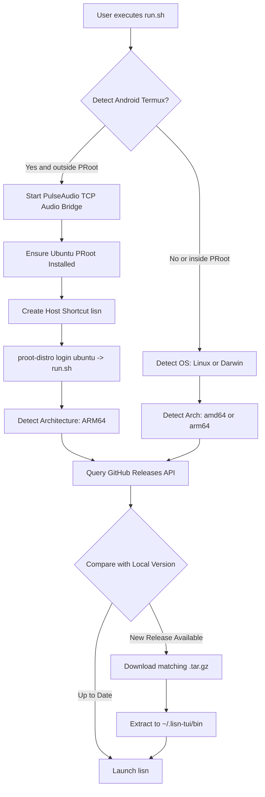

# LISN-TUI Architecture: Unified Dual-Runner Topology (Bash & PowerShell)

This specification defines the consolidated distribution topology for LISN-TUI, reducing multi-platform client entrypoints to two foundational shells: **POSIX Bash** (`run.sh`) and **Windows PowerShell** (`run.ps1`).

---

## 1. Design Rationale: The Simplicity Invariant

Previously, client distribution offered disparate scripts and documentation entrypoints:
- `termux.sh` for Android
- `run.sh` for Linux and macOS
- `run.ps1` for Windows

This created cognitive overhead for users, redundant maintenance across shell scripts, and cluttered landing page options.

By merging the mobile Termux environment detection, PulseAudio TCP routing, and PRoot Ubuntu bootstrap directly into `run.sh`, any Unix-like terminal environment — whether an x86 Linux server, macOS laptop, or Android smartphone — runs identically via:
```bash
curl -sSL https://raw.githubusercontent.com/shdynila/lisn-tui-releases/main/run.sh | bash
```

All Windows environments run identically via:
```powershell
irm https://raw.githubusercontent.com/shdynila/lisn-tui-releases/main/run.ps1 | iex
```

---

## 2. Inlined Mobile & Desktop Control Flow



---

## 3. Benefits of the Dual-Runner Architecture
1. **One Command Everywhere**: Documentation and landing pages present only two clean, intuitive copy-boxes.
2. **Automated Upgrades**: Both `run.sh` and `run.ps1` compare local version signatures against remote releases, acting as zero-overhead package managers.
3. **Unified Maintenance**: All Unix bootstrapping logic lives in a single version-controlled file (`run.sh`).
